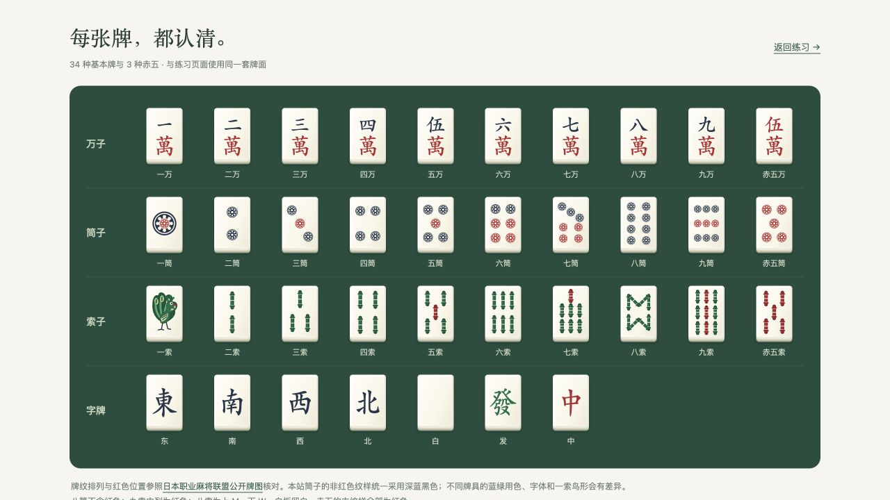

# 何切练习室

中文本地日麻何切练习网站，完整收录日文《麻雀 傑作「何切る」300選》的第 1–300 题。

下载或克隆本仓库即可在本地使用，包含全部运行资源，无需构建、安装 npm 包或连接外部服务。



## 打开网站

在 GitHub 点击 **Code → Download ZIP** 并完整解压，或使用 **Code** 菜单中的地址执行 `git clone`。保留整个项目文件夹，然后：

```bash
git clone https://github.com/Tarnished-Dan/riichi-300-practice.git
cd riichi-300-practice
```

- **Windows**：双击根目录的 **启动网站-Windows.cmd**，使用默认浏览器离线打开，不需要安装 Python。
- **macOS**：双击根目录的 **何切练习室.app**（麻将图标）；支持 Apple Silicon（macOS 12+）和 Intel（macOS 13+），按当前位置寻找网站。有 Python 时使用本机 HTTP 服务，没有时自动打开离线 HTML 入口。更早的系统可使用通用 HTML 入口。
- **通用入口**：双击 **打开练习网站.html**，在默认浏览器中离线使用。

启动图标、`dist`、`scripts` 应一起保留，可以移动或重命名整个文件夹。另见 `使用说明.txt`。这是本地运行项目，仓库链接用于下载源码和资源。

macOS 也可双击 **启动网站.command**，使用本机网址：

**http://127.0.0.1:8765**

启动窗口保持开启即可练习；按 `Ctrl+C` 或关闭该终端窗口可停止服务。服务器仅监听本机，不会发布到互联网，不需要安装 npm 包或联网。

如果 macOS 不允许双击脚本，可以在这个文件夹中打开终端运行：

```bash
/usr/bin/python3 scripts/serve.py
```

也提供 **打开练习网站.html**，可直接打开静态文件；若浏览器限制文件页面的本地存储，请使用上面的本机网址。尽量固定使用同一浏览器、同一入口，`file://`、`localhost` 和 `127.0.0.1` 的记录不会互通。

## 已包含的功能

- 第 1–300 题完整目录、每 50 题分组、题号跳转、上一题／下一题、随机未做。
- 可点击的麻将手牌，区分摸入牌、副露、赤牌、宝牌指示牌。
- 正误判定、简体中文具体解析、原书题面及答案图对照。
- 已做、未做、错题筛选与进度；保存练习次数、上次选择及对错记录。
- 清除记录前二次确认；取消保留记录。
- 第 132 题支持暗杠；持有四张同牌时，点击其中一张可切换“暗杠”操作。
- 第 63 题既接受主要推荐八万，也接受原书明确认可的六索。

记录保存在浏览器 `localStorage` 中。清除网站数据、更换浏览器或入口不会迁移已有记录。

## 资料与翻译

- 题库只采用用户提供的 **何切300.pdf**。**何切301.pdf 是另一部续作，没有混入本题库。**
- 题面、推荐切牌和牌理均以原书为依据；中文为本站整理的译解，不是出版方官方译本。
- 每题保留原 PDF 页码、原题图和答案图，便于核对；页面中显示的是 PDF 页码，而非纸书印刷页码。
- 原书进张计数不扣除宝牌指示牌或刚切出的牌，退向听后摸回刚切出的牌也计为有效进张。页面附有说明。
- 判定依据当前场况。解析可能提及其他场况下的选择；立直等后续操作会在解析中说明。
- 第 288 题原文“庄家满贯”与题面西家存在表述矛盾；译解保留其牌理和打点论证，不重复矛盾分值，详见 `data/translation-notes.json`。
- 牌面为原创 SVG，参考雀魂的清晰牌纹与浅色立体牌身，运行时没有外部字体、图片或接口依赖。
- 全套牌纹排列与红色位置已参照[日本职业麻将联盟公开牌图](https://www.ma-jan.or.jp/about/haiga.html)核对。筒子的非红纹样统一采用深蓝黑色；八筒无红，九索中列红，八索上 M 下 W。网站底部“查看全部牌面”可查看与练习页共用的 37 种牌面。

## 文件

| 路径 | 用途 |
| --- | --- |
| `dist/` | 可独立复制的完整静态网站 |
| `data/questions.json` | 300 题结构化数据 |
| `data/translations-*.json` | 分段的中文译解源文件 |
| `data/source-structure.json`、`data/tile-data.json`、`data/question-contexts.json` | 已核对的题库构建输入，不依赖 OCR 缓存 |
| `scripts/serve.py` | 本地静态服务器 |
| `scripts/build_data.py` | 校验并合并题库；缺任何中文解析都会报错 |
| `scripts/extract_original.py` | 从原 PDF 提取题目和答案图片 |
| `scripts/recognize_tiles.py`、`scripts/build_tile_data.py` | 牌面识别及人工校对后的映射 |
| `scripts/ocr.swift`、`scripts/map_ocr.py` | 本地日文 OCR 及坐标关联 |
| `tmp/pdfs/` | 本地提取、识别及核对的中间资料，不纳入仓库 |

网站使用原生 HTML、CSS、JavaScript。正常使用不需要 OCR、PDF 或 Python 第三方依赖；可选的本地 HTTP 服务需要 Python 3。

## 题库维护与仓库范围

仓库保留 `dist/` 的完整题面、答案图和运行文件，`data/` 中的结构化题库与中文译解，以及生成脚本、Windows / macOS 启动入口。练习记录只保存在使用者自己的浏览器中，不随仓库上传。

修改中文译解后，运行 `python3 scripts/build_data.py` 即可重新校验并生成题库；这一过程只使用仓库内的数据，不需要原 PDF 或第三方 Python 包。

原始 PDF、`tmp/` 中的 OCR 与图像识别缓存、`desktop/` 构建副本和 ZIP 包不纳入仓库。正常练习无需这些文件。若需从原书重新提取题目、运行 OCR 或重新识别牌面，需要自行准备对应的 `何切300.pdf` 及脚本所需的 Python / macOS 工具；这些提取脚本用于题库制作，不属于网站启动流程。

本项目未声明开源许可证。原书题目、答案图及相关内容的权利属于原权利人；公开仓库并不意味着对这些素材授予开源许可。中文译解为本站整理，来源与原书页码保留在题库中。

## 验证

- 300 个连续题号；全部具有手牌、答案、场况、中文解析和存在的原题／答案图。
- 手牌张数、排序和每种牌不超过四枚检查；300 道主推荐答案均与中文译解独立对照，并修正图像识别中六处“三万／五万”误匹配。
- 浏览器实测：正确与错误判分、刷新恢复记录、错题筛选、300 题目录、跳转末题、原答案图片、取消清除／确认清除及刷新后保持清空。
- 特别实测：第 132 题暗杠、第 154 题副露与“和牌即一位”、第 173 题赤五／普通五、第 63 题认可备选。
- 自动浏览器只允许 HTTP/HTTPS，因此直接双击 HTML 的文件协议入口未做自动浏览器验证；本机 HTTP 入口已实测。
- Windows 启动脚本已检查，尚未在 Windows 实机验证。
